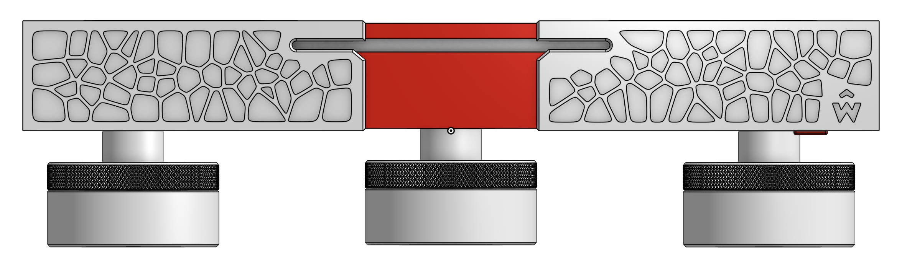
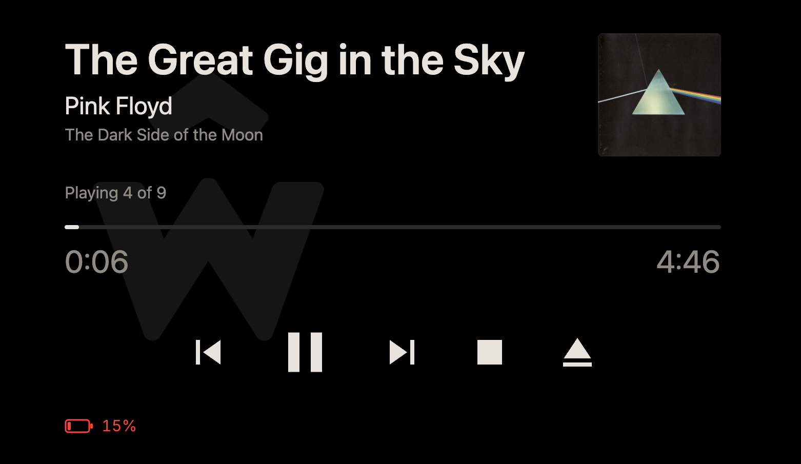

# sŵn

"sŵn" is a no nonsense memory based transport for compact discs. It is designed to allow for effortless playback with a focal point on sound quality and the music experience.

It's primary premise is to eliminate the drawbacks of the physical transport and incorporate error correction and memory playback in a seamless experience.

It has no screens and no physical buttons, apart from eject. It does not upsample, nor modify the stream in any manner. It discourages seeking and skipping tracks, yet it allows for it. Playback starts within seconds while the rest of the disc loads in the background. Skipping ahead is possible, and simply waits for the next track to finish loading.

What it does is reads each track into volatile memory before it is played, so playback never waits on the drive, and leaves the DAC to do the heavy lifting.

sŵn is not for everyone.

# Concept

sŵn is based on off-the-shelf hardware.

The workings of the system are a combination of mechanical hardware design (suspension + damping) and a standard software implementation - the combination of which aims to eliminate the shortcomings of a typical CD transport - (1) mechanical noise and feedback due to the fast spinning mechanism and (2) limited error correction due to direct output of the audio stream.

## Hardware

sŵn is designed around a Raspberry Pi 5 board with 2GB of RAM, and a USB connected slot loading drive, specifically a Apple Superdrive. The power supply is a standard RPi 27W PSU, enabling full power over USB to eliminate throttling when the drive is used along with the RPi.

The drive is mounted on a three point cradle with integrated o-ring suspension, akin to the suspension concepts used for studio recording microphones. This approach allows for both reduction of vibration, and six degrees of damping.

The entire enclosure is mounted on larger feet featuring the same type of suspension, in a configuration mirrored to the drive cradle, to reduce parasitic vibrationary motion.

This is an approximate model of the enclosure, viewed from the front.



There are no screens, and no buttons save from an eject button mounted on the underside of the enclosure to the right side when viewed from the front.

The rear of the enclosure features four cutouts for a Neutrik D-style connector, two PSU connectors on the left (when seen from the back), and one EtherCon and one NA-USB on the right.

The only avaiable output by default is USB.

An Apple Siri remote is optional.

## Software

sŵn is based on a RaspOS Lite, with a set of several scripts built in Python to handle playback and playback controls.

A browser based interface available on the default HTTP port to show basic information about the disc and track, including cover art and general loading status.

Source code and installation scripts are in the ```swn-core``` folder, along a separate installation specific readme.

## Control

sŵn features a browser based interface that allows for basic playback controls.




An additional control layer is possible via the use of an Apple Siri remote, with standard mapping and the Siri button performing the eject routine.

## Enclosure

sŵn requires the specific enclosure as a crucial part of its operation. The enclosure is designed to incorporate damping and vibration reduction for both the transport and the entirety of the asssembly.

The entire enclosure is 3D printed using PLA, with the exception of several threaded inserts and a selection of precision o-rings.

Individual STL files, along with a printing and assembly order are in the ```swn-enclosure``` folder.

## Workings

sŵn is a small chain of standard tools, each doing one job.

**Drive.** The SuperDrive will not take a disc until it receives a wake-up command, so a udev rule sends it one whenever the drive appears on USB. A second rule starts the loader whenever a disc is detected.

**Loading.** The loader reads the table of contents, then reads each track from the disc with cdparanoia and writes it as a WAV file into a RAM disk (tmpfs). Track 1 is created at its full size up front. Its first part is read and written first, playback starts, and the remainder is filled in afterwards into the same file. The other tracks follow in order.

**Playback.** MPD plays the files straight from the RAM disk, gapless, through a direct ALSA connection to the DAC. There is no mixer, no resampling and no software volume in the path, so the audio leaves as 16-bit/44.1 kHz exactly as it was read.

**Metadata.** The disc's track layout is looked up on MusicBrainz, and the cover is fetched from the Cover Art Archive. A result is accepted only if the track count matches, the track lengths agree within a few seconds, and the candidates come from a single album, otherwise the disc is left with generic names. The lookup runs alongside the first read with a time limit, so it can never delay playback. Titles are stored as tags inside the WAV files, so nothing outside the RAM disk remembers what was played.

**Interface.** The browser interface is a small Python web server using only the standard library. It polls MPD for status and turns button presses into MPD commands. The eject script runs with elevated rights, and the interface may run that one script and nothing else.

**Controls.** The eject button is a GPIO input read by a small service. The Siri remote's button reports are read from the Bluetooth monitor, since the standard Linux stack cannot read this remote, and are mapped to the same actions as the interface.

Everything runs as systemd services and is installed by a single script.

# Operation

Push a disc into the slot and sŵn does the rest.

The drive pulls the disc in, reads its table of contents and starts loading. If there is a valid network connection, it also looks up the album title, track names and cover art, and they appear in the browser interface within moments. Without a network, the disc simply plays with generic track names.

Playback starts after roughly fifteen seconds, as soon as the beginning of the first track is in memory. The rest of the disc keeps loading in the background, track by track, always ahead of what is playing. The interface shows how far loading has come. A full disc is typically in memory after a few minutes, and once it is, the drive goes quiet.

From the first note onwards, the music is played from volatile memory and never from the disc. Tracks follow each other without gaps, and the audio reaches the DAC over USB as it was read, with no resampling and no volume change. Skipping ahead to a track that is still loading simply waits until it is ready.

Nothing is kept after listening. Ejecting, by the button, the browser interface or the remote, stops playback, clears the memory and returns the disc. Cutting the power does the same.