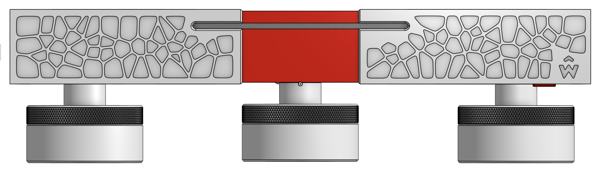

# sŵn

"sŵn" is a no nonsense memory based transport for compact discs. It is designed to allow for effortless playback with a focal point on sound quality and the music experience.

It's primary premise is to eliminate the drawbacks of the physical transport and incorporate error correction and memory playback in a seamless experience.

It has no screens and no physical buttons, apart from eject. It does not upsample, nor modify the stream in any manner. It discourages seeking and skipping tracks.

What it does have is storing the audio stream in volatile memory, performing error correction and leaving the DAC to do the heavy lifting.

sŵn is not for everyone.

# Concept

sŵn is based on off-the-shelf hardware.

The workings of the system are a combination of mechanical hardware design (suspension + damping) and a standard software implementation - the combination of which aims to eliminate the shortcomings of a typical CD transport - (1) mechanical noise and feedback due to the fast spinning mechanism and (2) lack of error correction.

## Hardware

sŵn is designed around a Raspberry Pi 5 board with 2GB of RAM, and a USB connected slot loading drive, specifically a Apple Superdrive. The power supply is a standard RPi 27W PSU, enabling full power over USB to eliminate throttling when the drive is used along with the RPi.

The drive is mounted on a three point cradle with integrated o-ring suspension, akin to the suspension concepts used for studio recording microphones. This approach allows for both reduction of vibration, and six degrees of damping.

The entire enclosure is mounted on larger feet featuring the same type of suspension, in a configuration mirrored to the drive cradle, to reduce parasitic vibrationary motion.

This is an approximate model of the enclosure, viewed from the front.

There are no screens, and no buttons save from an eject button mounted on the underside of the enclosure to the right side when viewed from the front.

The rear of the enclosure features four cutouts for a Neutrik D-style connector, two PSU connectors on the left (when seen from the back), and one EtherCon and one NA-USB on the right.

The only avaiable output by default is USB.

## Software

sŵn is based on a RaspOS Lite, with a set of several scripts built in Python to handle playback and playback controls.

Playback control is possible through a browser based interface available on the default HTTP port. It shows basic information about the disc and track, including cover art and general loading status.